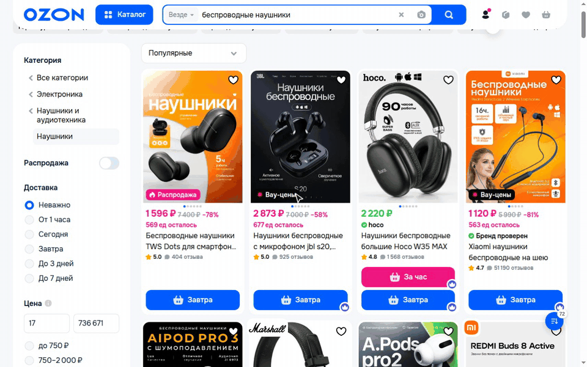
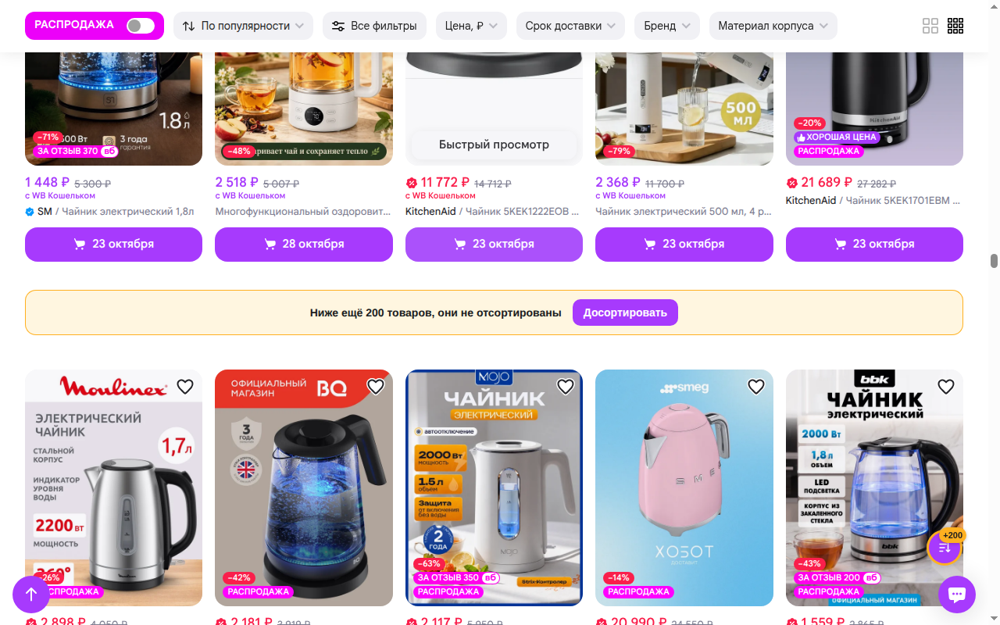
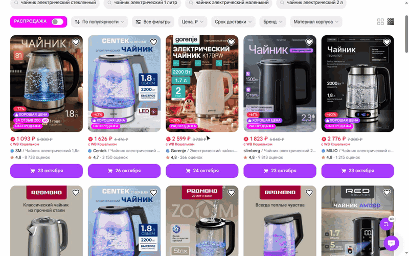

# SuliMarket - сортировка Ozon и Wildberries по количеству отзывов

[](CHANGELOG.md)
[](LICENSE)
[](#как-установить)
[](#через-tampermonkey)

SuliMarket - бесплатное расширение для Chrome и Яндекс Браузера, которое сортирует выдачу **Ozon по количеству
отзывов** и **Wildberries по количеству оценок**. Один клик - и наверху стоят товары, которые купили и оценили тысячи
людей, а не карточки с пятью звёздами от трёх покупателей.

> "На 1 товаре за 20500 средний балл 4.8 на 31 отзыв, а на 2 товаре за 20300 4.7 на 97 отзывов, какой товар лучше мне взять?" -
> [вопрос на Ответах Mail](https://otvet.mail.ru/question/242466045), 2025

Сами сайты так не умеют:

| Сайт | Какие сортировки есть | По количеству отзывов |
| --- | --- | --- |
| Ozon | Популярные, Новинки, Дешевле, Дороже, С высоким рейтингом, С большими скидками | нет |
| Wildberries | По популярности, По рейтингу, По цене, По новинкам | нет |
| Сайт с SuliMarket | все сортировки сайта плюс одна кнопка | да, от большего к меньшему |

Списки сортировок сверены на ozon.ru и wildberries.ru 20 октября 2026 года.



> **Быстрый старт.** Поставьте расширение, откройте поиск или категорию на Ozon или Wildberries и нажмите круглую
> кнопку в правом нижнем углу. Подробно - в разделе [Как установить](#как-установить).

---

## Содержание

- [Что умеет SuliMarket?](#что-умеет-sulimarket)
- [Почему не хватает сортировки по рейтингу?](#почему-не-хватает-сортировки-по-рейтингу)
- [Как установить?](#как-установить)
- [Как пользоваться?](#как-пользоваться)
- [Как SuliMarket работает с AI-агентами?](#как-sulimarket-работает-с-ai-агентами)
- [Частые вопросы](#частые-вопросы)
- [Что SuliMarket видит и куда отправляет?](#что-sulimarket-видит-и-куда-отправляет)
- [Как это устроено?](#как-это-устроено)
- [Как собрать из исходников?](#как-собрать-из-исходников)
- [Лицензия и автор](#лицензия-и-автор)

---

## Что умеет SuliMarket?

| Возможность | Как работает |
| --- | --- |
| Сортировка по количеству отзывов | Ozon - по отзывам, Wildberries - по оценкам, от большего к меньшему. При равном количестве выше тот, у кого выше рейтинг |
| Только основная выдача | Полки "Вы смотрели", "Возможно, вам понравится" и реклама в сортировку не попадают |
| Вёрстка сайта цела | Карточки того же размера, что у сайта. Работают "В избранное", корзина и переход к товару |
| Догрузить и отсортировать | Листает выдачу 3, 5, 10 секунд или своё число секунд, потом сортирует всё загруженное |
| Новые товары не теряются | Если сайт догрузил товары после сортировки, кнопка становится жёлтой с `+N`, а на странице появляется плашка "Досортировать" |
| "Как было" | Возвращает порядок сайта одним нажатием |
| "Держать" | Смена фильтра, категории, поиска или возврат назад - новая выдача сортируется сама |
| Кнопка не мешает | Круглую кнопку можно перетащить в любое место. Место запоминается отдельно для Ozon и Wildberries |
| Живой счётчик | Число на кнопке показывает, сколько товаров загружено или отсортировано |



---

## Почему не хватает сортировки по рейтингу?

Рейтинг не говорит, сколько людей его поставили. Товар с оценкой 5,0 от трёх покупателей встаёт выше товара с оценкой
4,8 от 40 000 покупателей.

Покупатели это знают: 83% изучают отзывы перед покупкой в интернете, и 55% считают, что фейковых отзывов примерно
столько же, сколько настоящих, или больше ([НАФИ, 2023](https://nafi.ru/polls/kak-izmenilos-otnoshenie-rossiyan-k-otzyvam-o-tovarakh-v-internete/)).
Только на рейтинг смотрят 4% покупателей ([Роскачество, 2025](https://rskrf.ru/news/43-rossiyan-obrashchayut-vnimanie-na-otzyvy-i-reytingi-pri-pokupke-onlayn/)).

Количество отзывов показывает, сколько людей товар купили и написали о нём. Поэтому SuliMarket ставит наверх товары
с большим количеством отзывов, а рейтинг использует только при равенстве. Рейтинг виден на каждой карточке, как и
раньше.

---

## Как установить?

### Расширение (рекомендуется)

| Браузер | Где взять |
| --- | --- |
| Google Chrome, Яндекс Браузер, Opera | Chrome Web Store - ссылка появится после публикации |
| Microsoft Edge | Edge Add-ons - ссылка появится после публикации |

Яндекс Браузер, Opera и другие браузеры на Chromium ставят расширения из Chrome Web Store.

Расширение обновляется само через магазин.

### Через Tampermonkey

Если у вас уже стоит [Tampermonkey](https://www.tampermonkey.net/) (Chrome, Firefox, Safari, Edge):

1. Откройте [`sulimarket.user.js`](https://github.com/sergeysulimko/sulimarket/releases/latest/download/sulimarket.user.js).
2. Tampermonkey покажет страницу установки - нажмите "Установить".

Скрипт проверяет обновления сам.

**Раньше стоял SSMarket** (старое имя этого же скрипта)? Откройте
[`ssmarket-bridge.user.js`](https://github.com/sergeysulimko/sulimarket/releases/latest/download/ssmarket-bridge.user.js)
и нажмите "Обновить". Tampermonkey обновит SSMarket, а при следующей проверке обновлений сам переименует его в
SuliMarket - второй копии не будет. Если SuliMarket всё же поставлен рядом со SSMarket, он уберёт кнопку SSMarket со
страницы и один раз напомнит удалить старый скрипт.

### Вручную, без магазина

1. Скачайте `sulimarket-<версия>-extension.zip` со страницы [Releases](https://github.com/sergeysulimko/sulimarket/releases)
   и распакуйте.
2. Откройте `chrome://extensions`, включите "Режим разработчика".
3. Нажмите "Загрузить распакованное расширение" и выберите папку.

Так расширение само не обновляется.

---

## Как пользоваться?

1. Откройте поиск или категорию на [ozon.ru](https://www.ozon.ru) или [wildberries.ru](https://www.wildberries.ru).
2. Нажмите круглую кнопку SuliMarket. Откроется панель.
3. Нажмите "Сортировать по отзывам" - отсортируются товары, которые уже загружены.
4. Нужно больше товаров - нажмите 3 с, 5 с или 10 с. SuliMarket пролистает выдачу столько секунд и отсортирует всё.
   Своё число секунд - в поле "N с", потом Enter или кнопка со стрелкой.
5. Вернуть порядок сайта - "Как было".

Кнопку можно перетащить мышью. Панель открывается в ту сторону, где больше места.



---

## Как SuliMarket работает с AI-агентами?

AI-агент с браузером (Claude, ChatGPT Agent, Operator, Comet, скрипт на Playwright) получает отсортированную выдачу
без кликов по панели. Нужен браузер, где стоит SuliMarket.

1. Откройте адрес выдачи с параметром `sulimarket`:
   - `?sulimarket` - отсортировать то, что сайт загрузил;
   - `?sulimarket=10` - листать выдачу 10 секунд, потом отсортировать всё загруженное (до 180 секунд).

   ```
   https://www.ozon.ru/search/?text=наушники&sulimarket=10
   https://www.wildberries.ru/catalog/0/search.aspx?search=чайник&sulimarket=10
   ```

2. Дождитесь `<html data-sulimarket-state="sorted">`. Пока SuliMarket ждёт сайт или листает, там `busy`.
3. Прочитайте JSON из `<script type="application/json" id="sulimarket-result">`:

   ```json
   {
     "version": "3.1.0",
     "site": "ozon",
     "countOf": "reviews",
     "state": "sorted",
     "url": "https://www.ozon.ru/category/feny-10739/?...",
     "items": [
       {
         "rank": 1,
         "title": "Компактный мощный Фен для волос со складной ручкой SC-074...",
         "url": "https://www.ozon.ru/product/kompaktnyy-moshchnyy-fen-...-1326742535/",
         "price": 1091,
         "count": 44615,
         "rating": 4.9
       }
     ]
   }
   ```

`count` - число отзывов на Ozon (`countOf: "reviews"`) или оценок на Wildberries (`countOf: "ratings"`), `price` - цена
в рублях с карточки. На уже открытой странице то же делает `#sulimarket` или `#sulimarket=10` в конце адреса.

Пример для Playwright:

```js
await page.goto('https://www.wildberries.ru/catalog/0/search.aspx?search=фен&sulimarket=10');
await page.waitForSelector('html[data-sulimarket-state="sorted"]', { timeout: 60000 });
const result = JSON.parse(await page.locator('#sulimarket-result').textContent());
console.log(result.items.slice(0, 5));
```

---

## Частые вопросы

### Как отсортировать Ozon по количеству отзывов?

Поставьте SuliMarket, откройте поиск или категорию на Ozon и нажмите кнопку SuliMarket - "Сортировать по отзывам".
Сам Ozon сортирует только по рейтингу, цене, новизне, скидке и популярности.

### Есть ли на Ozon сортировка по количеству отзывов?

Нет. На 20 октября 2026 года Ozon сортирует только по популярности, новизне, цене, рейтингу и скидке, а Wildberries -
по популярности, рейтингу, цене и новизне. SuliMarket добавляет сортировку по количеству отзывов на оба сайта.

### Как на Wildberries отсортировать товары по количеству оценок?

Так же: откройте выдачу Wildberries, нажмите кнопку SuliMarket - "Сортировать по оценкам". Wildberries показывает
у карточки число оценок, и SuliMarket сортирует по нему.

### Почему отсортировано не всё, что есть по запросу?

Ozon и Wildberries загружают выдачу частями по мере прокрутки. SuliMarket сортирует то, что уже загружено. Чтобы
захватить больше, нажмите 5 с или 10 с: SuliMarket сам пролистает выдачу и отсортирует всё загруженное.

### Сайт догрузил товары после сортировки. Что делать?

Ничего искать не нужно. Кнопка станет жёлтой с `+N`, а под отсортированными товарами появится плашка "Ниже ещё N
товаров, они не отсортированы". Нажмите "Досортировать".

### Я поменял фильтр, и сортировка пропала?

Не пропала, если включено "Держать" (включено сразу после установки). Сайт обновит выдачу, и SuliMarket
отсортирует её снова через 1-3 секунды. Выключите "Держать", если после смены фильтра нужен порядок сайта.

### Работает ли "В избранное" и корзина в отсортированной выдаче?

Да. На Wildberries SuliMarket переставляет настоящие карточки сайта. На Ozon он показывает копии карточек, а нажатия
на кнопки передаёт настоящей карточке.

### Работает ли SuliMarket в Яндекс Браузере?

Да. Яндекс Браузер ставит расширения из Chrome Web Store, поэтому SuliMarket ставится туда так же, как в Chrome.

### Защищает ли SuliMarket от накрученных отзывов?

Нет. Накрутить можно и количество отзывов. SuliMarket показывает, какие товары купило и оценило больше всего людей,
а читать отзывы перед покупкой всё равно стоит.

### Чем SuliMarket отличается от других скриптов для Ozon?

Есть скрипт [Ozon Sort by Reviews](https://greasyfork.org/ru/scripts/518731-ozon-sort-by-reviews) для Tampermonkey: он
сортирует Ozon по отзывам. SuliMarket работает и на Ozon, и на Wildberries, сортирует только основную выдачу без полок
рекомендаций, отмечает товары, догруженные после сортировки, держит сортировку при смене фильтра и умеет "Как было".

### Работает ли на телефоне?

Пока нет: SuliMarket рассчитан на версию сайтов для компьютера.

### Это бесплатно?

Да, бесплатно и без рекламы. Код открыт.

---

## Что SuliMarket видит и куда отправляет?

SuliMarket работает только на `www.ozon.ru` и `www.wildberries.ru`. Он читает карточки на открытой странице, чтобы
узнать число отзывов, и ничего никуда не отправляет: нет сервера, аналитики, рекламы и запросов к сторонним сайтам.

На вашем компьютере хранятся только настройки: место кнопки для каждого сайта, выбранные секунды, своё число секунд
и "Держать". Пока открыта вкладка, хранится ещё отметка, что сортировка включена. Подробно -
[политика конфиденциальности](PRIVACY.md).

---

## Как это устроено?

| Сайт | Как сортирует | Почему |
| --- | --- | --- |
| Ozon | Снимает копии карточек основной выдачи, пока они видны, и показывает отсортированную сетку с классами сайта на месте выдачи | Выдача Ozon виртуальная: страницы вдали от экрана выгружаются, переставить их нельзя |
| Wildberries | Переставляет настоящие карточки CSS-свойством `order` | Все загруженные карточки лежат в одной сетке, и разметку сайта трогать не нужно |

Основная выдача Ozon - это сетки `tileGridDesktop` внутри `infiniteVirtualPaginator` (поиск, категории) или
`megaPaginator` (подборки). У полок рекомендаций есть заголовок, поэтому они отсекаются. Карточка Wildberries - элемент
списка ровно с одним артикулом: рекламные карусели ссылаются на многие и в сортировку не попадают.

Число отзывов читается из отдельного текстового узла карточки. В склеенном тексте рейтинг "4.6" прилипает к "1 101
отзыв", и получается 61 101.

Если сайт перерисовал отсортированный список, SuliMarket сортирует его снова. Если стоят и расширение, и скрипт
Tampermonkey, работает тот, кто запустился первым, - кнопка одна.

---

## Как собрать из исходников?

Нужен Node.js 20 или новее и ImageMagick (`magick`).

```
npm run build
```

Сборка пишет в `dist/`:

- `sulimarket.user.js` - скрипт Tampermonkey;
- `extension/` - расширение Manifest V3;
- `sulimarket-<версия>-extension.zip` - архив для магазинов.

Код один - `src/core.js`. Скрипт и расширение отличаются только хранилищем настроек: `GM_getValue` у Tampermonkey и
`chrome.storage.local` у расширения.

Проверка - на живой выдаче: `test/inject.sh` вставляет собранный скрипт в открытую страницу браузера через CDP.

---

## Лицензия и автор

[MIT](LICENSE). Автор - Сергей Сулимко, [sulimko.com](https://sulimko.com), GitHub
[@sergeysulimko](https://github.com/sergeysulimko).

Нашли ошибку или сайт сменил вёрстку - [откройте issue](https://github.com/sergeysulimko/sulimarket/issues/new/choose).
Изменения по версиям - [CHANGELOG](CHANGELOG.md).
