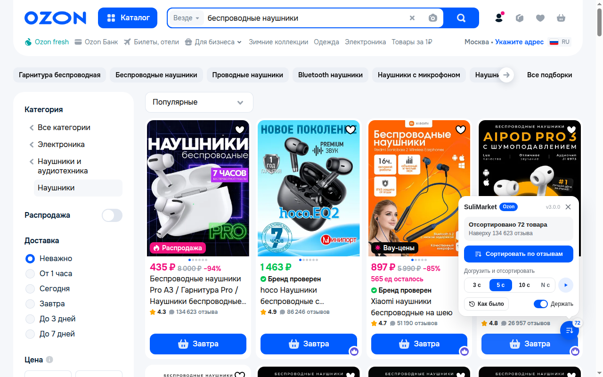

# SuliMarket - сортировка Ozon и Wildberries по числу отзывов

[](CHANGELOG.md)
[](LICENSE)
[](#как-установить)
[](#через-tampermonkey)

SuliMarket - расширение для браузера, которое сортирует выдачу **Ozon по числу отзывов** и **Wildberries по числу
оценок**. Один клик - и наверху стоят товары, которые купили и оценили тысячи людей, а не карточки с пятью звёздами
от трёх покупателей.

> "Как на Озоне отсортировать товары по количеству отзывов?"

Сам сайт так не умеет. У Ozon есть сортировки "Популярные", "Новинки", "Дешевле", "Дороже", "С высоким рейтингом" и
"С большими скидками". У Wildberries - "По популярности", "По рейтингу", "По цене" и "По новинкам". Сортировки по
числу отзывов нет ни там, ни там. SuliMarket её добавляет.



> **Быстрый старт.** Поставьте расширение, откройте поиск или категорию на Ozon или Wildberries и нажмите круглую
> кнопку в правом нижнем углу. Подробно - в разделе [Как установить](#как-установить).

---

## Содержание

- [Что умеет SuliMarket?](#что-умеет-sulimarket)
- [Почему не хватает сортировки по рейтингу?](#почему-не-хватает-сортировки-по-рейтингу)
- [Как установить?](#как-установить)
- [Как пользоваться?](#как-пользоваться)
- [Частые вопросы](#частые-вопросы)
- [Что SuliMarket видит и куда отправляет?](#что-sulimarket-видит-и-куда-отправляет)
- [Как это устроено?](#как-это-устроено)
- [Как собрать из исходников?](#как-собрать-из-исходников)
- [Лицензия и автор](#лицензия-и-автор)

---

## Что умеет SuliMarket?

| Возможность | Как работает |
| --- | --- |
| Сортировка по числу отзывов | Ozon - по отзывам, Wildberries - по оценкам, от большего к меньшему. При равном числе выше тот, у кого выше рейтинг |
| Только основная выдача | Полки "Вы смотрели", "Возможно, вам понравится" и реклама в сортировку не попадают |
| Вёрстка сайта цела | Карточки того же размера, что у сайта. Работают "В избранное", корзина и переход к товару |
| Догрузить и отсортировать | Листает выдачу 3, 5, 10 секунд или своё число секунд, потом сортирует всё загруженное |
| Новые товары не теряются | Если сайт догрузил товары после сортировки, кнопка становится жёлтой с `+N`, а на странице появляется плашка "Досортировать" |
| "Как было" | Возвращает порядок сайта одним нажатием |
| "Держать" | Смена фильтра, категории, поиска или возврат назад - новая выдача сортируется сама |
| Кнопка не мешает | Круглую кнопку можно перетащить в любое место. Место запоминается отдельно для Ozon и Wildberries |
| Живой счётчик | Число на кнопке показывает, сколько товаров загружено или отсортировано |


---

## Почему не хватает сортировки по рейтингу?

Рейтинг не говорит, сколько людей его поставили. Товар с оценкой 5,0 от трёх покупателей встаёт выше товара с оценкой
4,8 от 40 000 покупателей. Первые три отзыва часто пишут знакомые продавца, а при тысячах отзывов накрутка почти не
влияет на средний балл.

Число отзывов показывает, сколько людей товар реально купили и прожили с ним. Поэтому SuliMarket ставит наверх товары
с большим числом отзывов, а рейтинг использует только при равенстве. Рейтинг виден на каждой карточке, как и раньше.

---

## Как установить?

### Расширение (рекомендуется)

| Браузер | Где взять |
| --- | --- |
| Google Chrome, Яндекс Браузер, Opera | Chrome Web Store - ссылка появится после публикации |
| Microsoft Edge | Edge Add-ons - ссылка появится после публикации |

Яндекс Браузер, Opera и другие браузеры на Chromium ставят расширения из Chrome Web Store.

Расширение обновляется само через магазин.

### Через Tampermonkey

Если у вас уже стоит [Tampermonkey](https://www.tampermonkey.net/) (Chrome, Firefox, Safari, Edge):

1. Откройте [`sulimarket.user.js`](https://github.com/sergeysulimko/sulimarket/releases/latest/download/sulimarket.user.js).
2. Tampermonkey покажет страницу установки - нажмите "Установить".

Скрипт проверяет обновления сам. Если раньше стоял SSMarket - старое имя этого же скрипта, - удалите его в панели
Tampermonkey. SuliMarket уберёт кнопку SSMarket со страницы и один раз напомнит об этом.

### Вручную, без магазина

1. Скачайте `sulimarket-<версия>-extension.zip` со страницы [Releases](https://github.com/sergeysulimko/sulimarket/releases)
   и распакуйте.
2. Откройте `chrome://extensions`, включите "Режим разработчика".
3. Нажмите "Загрузить распакованное расширение" и выберите папку.

Так расширение само не обновляется.

---

## Как пользоваться?

1. Откройте поиск или категорию на [ozon.ru](https://www.ozon.ru) или [wildberries.ru](https://www.wildberries.ru).
2. Нажмите круглую кнопку SuliMarket. Откроется панель.
3. Нажмите "Сортировать по отзывам" - отсортируются товары, которые уже загружены.
4. Нужно больше товаров - нажмите 3 с, 5 с или 10 с. SuliMarket пролистает выдачу столько секунд и отсортирует всё.
   Своё число секунд - в поле "N с", потом Enter или кнопка со стрелкой.
5. Вернуть порядок сайта - "Как было".

Кнопку можно перетащить мышью. Панель открывается в ту сторону, где больше места.

---

## Частые вопросы

### Как отсортировать Ozon по количеству отзывов?

Поставьте SuliMarket, откройте поиск или категорию на Ozon и нажмите кнопку SuliMarket - "Сортировать по отзывам".
Сам Ozon сортирует только по рейтингу, цене, новизне, скидке и популярности.

### Как на Wildberries отсортировать товары по количеству оценок?

Так же: откройте выдачу Wildberries, нажмите кнопку SuliMarket - "Сортировать по оценкам". Wildberries показывает
у карточки число оценок, и SuliMarket сортирует по нему.

### Почему отсортировано не всё, что есть по запросу?

Ozon и Wildberries загружают выдачу частями по мере прокрутки. SuliMarket сортирует то, что уже загружено. Чтобы
захватить больше, нажмите 5 с или 10 с: SuliMarket сам пролистает выдачу и отсортирует всё загруженное.

### Сайт догрузил товары после сортировки. Что делать?

Ничего искать не нужно. Кнопка станет жёлтой с `+N`, а под отсортированными товарами появится плашка "Ниже ещё N
товаров, они не отсортированы". Нажмите "Досортировать".

### Я поменял фильтр, и сортировка пропала?

Не пропала, если включено "Держать" (включено сразу после установки). Сайт обновит выдачу, и SuliMarket
отсортирует её снова через 1-3 секунды. Выключите "Держать", если после смены фильтра нужен порядок сайта.

### Работает ли "В избранное" и корзина в отсортированной выдаче?

Да. На Wildberries SuliMarket переставляет настоящие карточки сайта. На Ozon он показывает копии карточек, а нажатия
на кнопки передаёт настоящей карточке.

### Работает ли на телефоне?

Пока нет: SuliMarket рассчитан на версию сайтов для компьютера.

### Это бесплатно?

Да, бесплатно и без рекламы. Код открыт.

---

## Что SuliMarket видит и куда отправляет?

SuliMarket работает только на `www.ozon.ru` и `www.wildberries.ru`. Он читает карточки на открытой странице, чтобы
узнать число отзывов, и ничего никуда не отправляет: нет сервера, аналитики, рекламы и запросов к сторонним сайтам.

На вашем компьютере хранятся только настройки: место кнопки для каждого сайта, выбранные секунды, своё число секунд
и "Держать". Пока открыта вкладка, хранится ещё отметка, что сортировка включена. Подробно -
[политика конфиденциальности](PRIVACY.md).

---

## Как это устроено?

| Сайт | Как сортирует | Почему |
| --- | --- | --- |
| Ozon | Снимает копии карточек основной выдачи, пока они видны, и показывает отсортированную сетку с классами сайта на месте выдачи | Выдача Ozon виртуальная: страницы вдали от экрана выгружаются, переставить их нельзя |
| Wildberries | Переставляет настоящие карточки CSS-свойством `order` | Все загруженные карточки лежат в одной сетке, и разметку сайта трогать не нужно |

Основная выдача Ozon - это сетки `tileGridDesktop` внутри `infiniteVirtualPaginator` (поиск, категории) или
`megaPaginator` (подборки). У полок рекомендаций есть заголовок, поэтому они отсекаются. Карточка Wildberries - элемент
списка ровно с одним артикулом: рекламные карусели ссылаются на многие и в сортировку не попадают.

Число отзывов читается из отдельного текстового узла карточки. В склеенном тексте рейтинг "4.6" прилипает к "1 101
отзыв", и получается 61 101.

Если сайт перерисовал отсортированный список, SuliMarket сортирует его снова. Если стоят и расширение, и скрипт
Tampermonkey, работает тот, кто запустился первым, - кнопка одна.

---

## Как собрать из исходников?

Нужен Node.js 20 или новее и ImageMagick (`magick`).

```
npm run build
```

Сборка пишет в `dist/`:

- `sulimarket.user.js` - скрипт Tampermonkey;
- `extension/` - расширение Manifest V3;
- `sulimarket-<версия>-extension.zip` - архив для магазинов.

Код один - `src/core.js`. Скрипт и расширение отличаются только хранилищем настроек: `GM_getValue` у Tampermonkey и
`chrome.storage.local` у расширения.

Проверка - на живой выдаче: `test/inject.sh` вставляет собранный скрипт в открытую страницу браузера через CDP.

---

## Лицензия и автор

[MIT](LICENSE). Автор - Сергей Сулимко, [sulimko.com](https://sulimko.com), GitHub
[@sergeysulimko](https://github.com/sergeysulimko).

Нашли ошибку или сайт сменил вёрстку - [откройте issue](https://github.com/sergeysulimko/sulimarket/issues/new/choose).
Изменения по версиям - [CHANGELOG](CHANGELOG.md).
